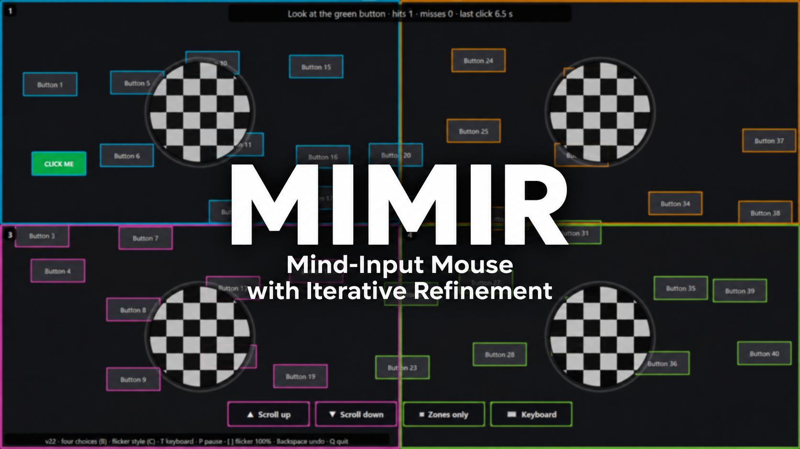
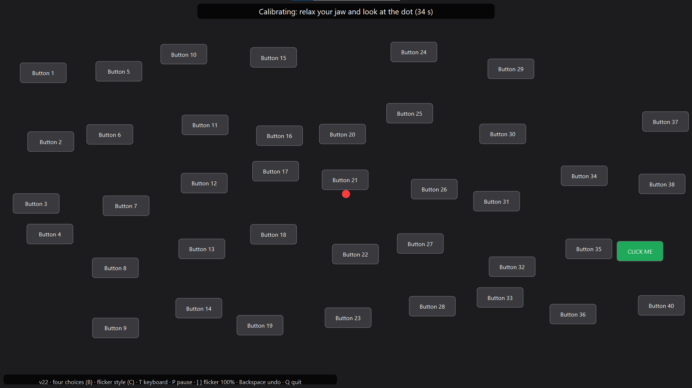
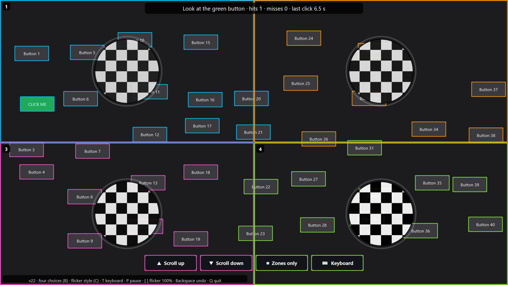
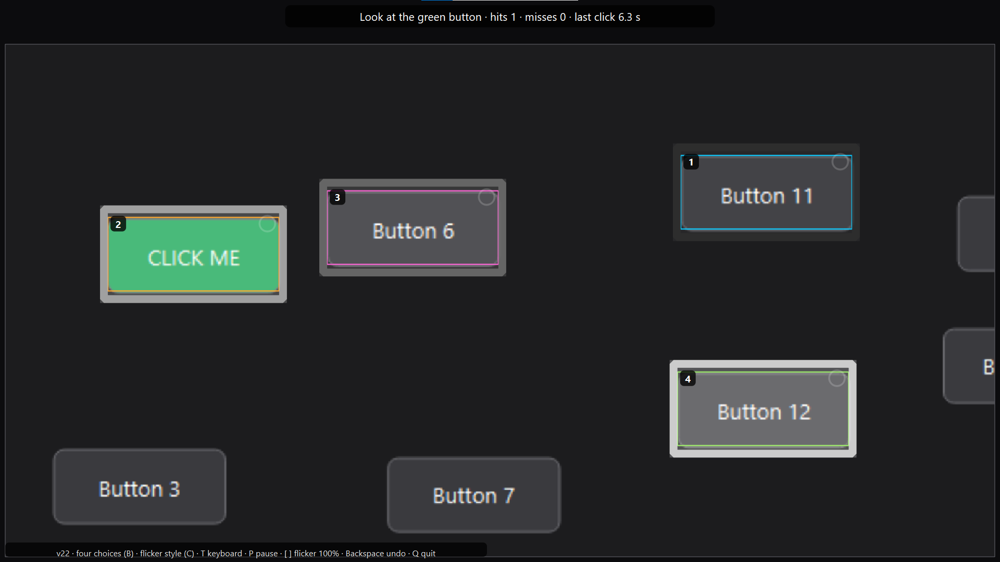
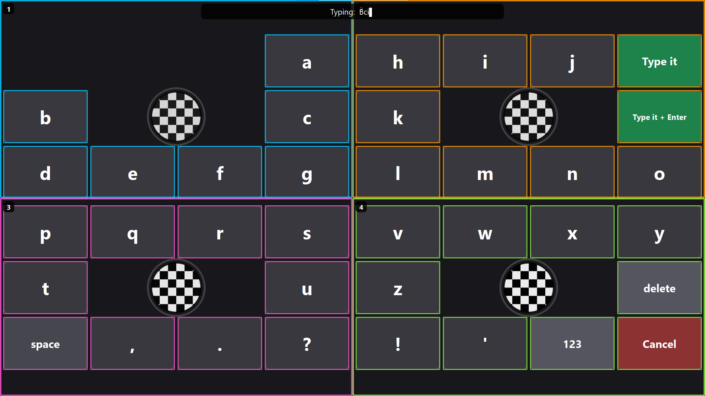
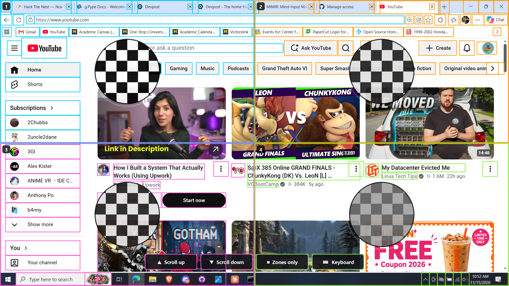

<p align="center">
  
</p>

<p align="center">
  <b>Click anything on your computer by looking at it.</b><br>
  A hands-free mouse for people who cannot use their hands, driven by a g.tec Unicorn EEG headset.
</p>

---

## How it works

The screen is split into up to four regions, each flickering at its own
speed (9, 10, 12 and 15 Hz). Looking at one makes your visual cortex echo that
frequency, and the decoder picks it up from the EEG (SSVEP).

1. **Pick a region.** The view narrows to what's inside it. Regions with
   nothing clickable are skipped.
2. **Zoom in.** Once 16 or fewer targets are left, the view is enlarged.
3. **Pick the button.** At the last step every candidate gets its own box.
4. **Choose the action.** Left click, double click, right click, or, for a
   text box, open the on-screen keyboard.

A short jaw clench undoes the last step; a long one starts over or pauses.
Buttons are found through Windows UI Automation, with an icon finder as a
fallback and a pixel grid that can reach any spot on the screen.

<table>
  <tr>
    <td align="center" colspan="2"><a href="Unicorn-quadclick/docs/screenshots/calibrate.png"></a><br><sub><b>1.</b> Calibrate: relax and look at the dot</sub></td>
    <td align="center" colspan="2"><a href="Unicorn-quadclick/docs/screenshots/quadrant.png"></a><br><sub><b>2.</b> Look at a region's checkered circle</sub></td>
    <td align="center" colspan="2"><a href="Unicorn-quadclick/docs/screenshots/button.png"></a><br><sub><b>3.</b> Last step: one box per button</sub></td>
  </tr>
  <tr>
    <td align="center" colspan="3"><a href="Unicorn-quadclick/docs/screenshots/type.png"></a><br><sub><b>4.</b> Type with the on-screen keyboard</sub></td>
    <td align="center" colspan="3"><a href="Unicorn-quadclick/docs/screenshots/youtube.png"></a><br><sub><b>5.</b> Works on the real desktop</sub></td>
  </tr>
</table>

> [!WARNING]
> The regions flicker at 9–15 Hz, which can trigger seizures in people with
> photosensitive epilepsy. Don't run it with or near anyone who has that
> condition, and say so before any demo.

## Try it

```
cd Unicorn-quadclick
pip install -r requirements.txt
python overlay.py --demo --keys-only     # practice screen, keyboard only
```

Press the number on a box to pick it. To drive it with recorded brain data
instead of the keyboard, run `python overlay.py --demo` and, in a second
terminal, `python replay_dataset.py`. On Windows, the numbered `.bat`
launchers do all of this with a double-click.

## Results

Replaying the g.tec SSVEP dataset through the live decision rule
(40 trials per subject):

| Subject | Right | Wrong | No answer | Time per pick |
|---|---|---|---|---|
| 1 | 40 | 0 | 0 | 2.4 s |
| 2 | 36 | 2 | 2 | 3.9 s |

A full click on a screen of about 64 buttons takes 3 picks, roughly 10–15 s.

## More

Setup for the live headset and the real desktop, every keyboard shortcut,
tuning, the full results and what is still untested are in
[Unicorn-quadclick/README.md](Unicorn-quadclick/README.md).
